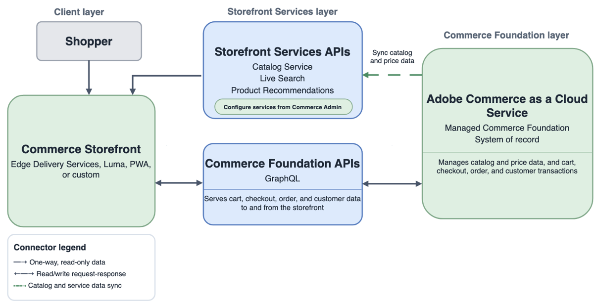

# Implementation architecture options

Adobe Commerce implementation architectures combine three layers: a commerce backend ([!DNL Adobe Commerce] or [!DNL Adobe Commerce Optimizer]), a storefront, and a set of connected services and integrations. Compare the following options to identify which system owns catalog, pricing, cart, checkout, orders, and customer transactions in each architecture.

## Architecture options summary

Compare the options by transaction ownership and by storefront experience.

### Commerce platform and transactions

| Option | System of record | Transaction path | Best fit |
| --- | --- | --- | --- |
| **[!DNL Adobe Commerce as a Cloud Service] with Commerce Foundation** | Adobe-managed Commerce Foundation | Managed Commerce Foundation and connected Commerce services | Customers that want Adobe-managed software as a service (SaaS) Commerce with reduced infrastructure ownership |
| **[!DNL Adobe Commerce] on Cloud or on premises with the [!DNL Adobe Commerce Optimizer Connector]** | Existing Commerce Foundation, for Commerce data and transactions | Existing Commerce Foundation APIs and connected transaction services | Customers that want to add Optimizer discovery and merchandising capabilities to an existing [!DNL Adobe Commerce] deployment |
| **Stand-alone [!DNL Adobe Commerce Optimizer] with an external commerce backend** | Existing or third-party commerce platform. Catalog and price data are added to Optimizer from an external source | API Mesh, App Builder, or direct integrations connect the storefront to third-party cart, checkout, customer, order, payment, tax, shipping, and fulfillment services | Customers that want Optimizer capabilities while retaining an existing or third-party transactional commerce platform |
| **[!DNL Adobe Commerce] on Cloud or on premises with Commerce Foundation** | Commerce Foundation | Commerce Foundation APIs and configured payment, tax, shipping, inventory, and fulfillment integrations | Customers that need the full [!DNL Adobe Commerce] platform with deployment control over cloud or on-premises infrastructure |

### Storefront experience

Storefronts connect to Commerce Foundation APIs, Storefront Services ([!DNL Catalog Service], [!DNL Live Search], and [!DNL Product Recommendations]), or [!DNL Adobe Commerce Optimizer] Merchandising Services.

| Option | Storefront experience | Storefront data path |
| --- | --- | --- |
| **[!DNL Adobe Commerce as a Cloud Service] with Commerce Foundation** | Commerce Storefront powered by Edge Delivery Services or another supported headless experience | Storefront Services, plus Commerce Foundation APIs for core platform data |
| **[!DNL Adobe Commerce] on Cloud or on premises with the [!DNL Adobe Commerce Optimizer Connector]** | Edge Delivery Services or custom headless storefront using Optimizer experiences | Commerce Optimizer Merchandising Services GraphQL APIs for Optimizer-managed catalog and merchandising data |
| **Stand-alone [!DNL Adobe Commerce Optimizer] with an external commerce backend** | Commerce Storefront powered by Edge Delivery Services or a custom headless storefront | Commerce Optimizer Merchandising Services GraphQL APIs for catalog and merchandising data |
| **[!DNL Adobe Commerce] on Cloud or on premises with Commerce Foundation** | Edge Delivery Services, Luma, PWA, or custom headless storefront | Commerce Foundation APIs, plus Storefront Services when configured |

## Adobe Commerce as a Cloud Service

{width="600" zoomable="yes"}

**Key boundary**—Adobe manages the Commerce Foundation platform. The architecture uses Storefront Services, including [!DNL Catalog Service], [!DNL Live Search], and [!DNL Product Recommendations], for storefront experiences. [!DNL Product Visuals] powered by AEM Assets is an optional SaaS integration. See [AEM Assets integration for Commerce](../aem-assets/aem-assets-integration.md).

**References:**

- [[!DNL Adobe Commerce as a Cloud Service] overview](/help/cloud-service/overview.md)
- [Commerce Storefront](https://experienceleague.adobe.com/en/tools/commerce-storefront/)
- [Storefront Services GraphQL schema](https://developer.adobe.com/commerce/webapi/graphql/schema/storefront-services/)

## Adobe Commerce with Commerce Foundation

{width="600" zoomable="yes"}

**Key boundary**—Commerce Foundation owns the Commerce platform and transaction flows. [!DNL Catalog Service], [!DNL Live Search], and [!DNL Product Recommendations] provide optimized storefront access to catalog, search, and recommendations when configured. AEM Assets integration is optional. See [AEM Assets integration for Commerce](../aem-assets/aem-assets-integration.md).

**References:**

- [Commerce Storefront](https://experienceleague.adobe.com/en/tools/commerce-storefront/)
- [Commerce GraphQL API](https://developer.adobe.com/commerce/webapi/graphql/)
- [Storefront Services GraphQL schema](https://developer.adobe.com/commerce/webapi/graphql/schema/storefront-services/)

## Adobe Commerce with the Optimizer Connector

{width="600" zoomable="yes"}

**Key boundary**—The Connector synchronizes catalog and price data from [!DNL Adobe Commerce] to [!DNL Adobe Commerce Optimizer]. [!DNL Adobe Commerce] remains the transaction system, while Optimizer supplies discovery and merchandising experiences through its Merchandising Services APIs.

**References:**

- [Commerce Optimizer Integrations](/help/optimizer/integrations/integrations-overview.md)
- [Commerce Optimizer Merchandising Services](https://developer.adobe.com/commerce/services/optimizer/merchandising-services/)
- [Commerce GraphQL API](https://developer.adobe.com/commerce/webapi/graphql/)
- [Commerce Storefront](https://experienceleague.adobe.com/en/tools/commerce-storefront/)

## Stand-alone Commerce Optimizer with a third-party backend

{width="800" zoomable="yes"}

**Key boundary**—Stand-alone [!DNL Adobe Commerce Optimizer] owns catalog discovery and merchandising experiences, but not the transactional Commerce backend. Catalog and price data enter through the Data Ingestion REST API. The Edge Delivery Services storefront uses Merchandising Services GraphQL APIs for product experiences and connects to the third-party backend for cart and checkout.

**References:**

- [What is Adobe Commerce Optimizer?](/help/optimizer/overview.md)
- [Commerce Optimizer Data Ingestion](https://developer.adobe.com/commerce/services/optimizer/data-ingestion/)
- [Commerce Optimizer Merchandising Services](https://developer.adobe.com/commerce/services/optimizer/merchandising-services/)
- [Commerce Storefront](https://experienceleague.adobe.com/en/tools/commerce-storefront/)

## Terminology quick reference

| Preferred term | Meaning | Avoid using as a current architecture label |
| --- | --- | --- |
| **Commerce Foundation** | Base commerce and transactional capabilities | Core Commerce, PHP Foundational Layer |
| **Storefront Services** | Storefront-oriented APIs for Catalog Service, Live Search, and Product Recommendations | A label limited to only one Commerce platform |
| **Commerce Optimizer Merchandising Services** | Optimizer APIs for catalog discovery and merchandising experiences | Commerce Foundation APIs |
| **Commerce Storefront powered by Edge Delivery Services** | Customer-facing storefront implementation | An API family |

## Related guidance

- [Reference architectures](reference-architectures.md)
- [Choose a Commerce option](../portfolio/choose-commerce-option.md)
- [Storefronts](../storefronts/overview.md)
- [APIs](../apis/commerce-apis.md)
