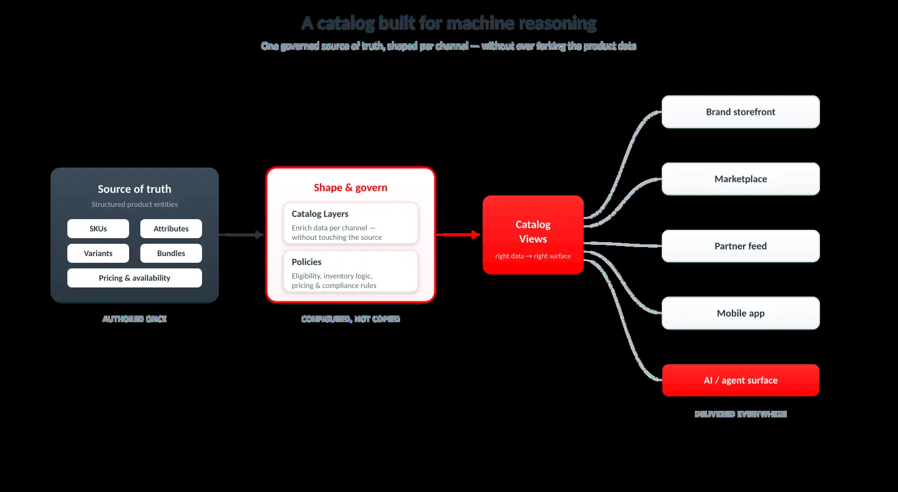

# The Architectural Foundations of an Agentic Commerce Platform

**By Surya Lamech**

*Agentic commerce is changing how products are discovered, evaluated, and purchased. The next generation of commerce platforms must serve both people and the AI agents acting on their behalf.*

## Overview

Agentic commerce enables artificial intelligence (AI) agents to act on behalf of shoppers and businesses. An agent can interpret intent, discover and compare products, apply constraints, and—when authorized—complete a transaction.

This model changes the requirements for commerce architecture. A storefront designed primarily for human browsing is not enough. The platform must also expose trustworthy, machine-readable data and secure, deterministic capabilities that agents can discover and use.

The architectural goal is therefore a **dual-audience commerce platform**: one that supports rich, brand-led experiences for people and reliable, policy-controlled interactions for AI agents.

## Key takeaways

* Design commerce experiences for both human shoppers and machine consumers.
* Treat the catalog as governed, machine-readable product knowledge—not only as presentation content.
* Expose commerce capabilities through predictable APIs and standardized protocols.
* Separate the experience, transaction, and data layers so each can evolve independently.
* Preserve human intent and control through identity, authorization, confirmation, and auditability.
* Build trust, security, and observability into every agent interaction.

## A dual-audience architecture

Human shoppers and AI agents interact with commerce in fundamentally different ways.

People may browse a storefront, respond to visual storytelling, compare products, and explore a brand experience. AI agents typically work from structured data and explicit capabilities. They need to understand product attributes, pricing, availability, eligibility, policies, and transaction rules without inferring them from a page layout or client-side JavaScript.

A dual-audience architecture does not replace the storefront. Instead, it adds an agent-facing surface alongside the human-facing experience. Both surfaces should use consistent business rules and trusted sources of truth.

This separation allows a merchant to:

* Preserve the storefront as a destination for brand expression, rich media, customization, and immersive experiences.
* Provide agents with structured catalog views and predictable endpoints.
* Keep pricing, inventory, promotion, cart, checkout, payment, and order logic consistent across channels.
* Add new agent surfaces without rebuilding the transactional core for each provider or model.

## Make the catalog machine-reasonable

The catalog is the foundation of agentic commerce. An agent cannot make a reliable recommendation or purchase decision from incomplete, ambiguous, or stale product information.

A machine-reasonable catalog is:

* **Structured:** Product names, descriptions, attributes, specifications, compatibility, variants, media, pricing, availability, and fulfillment information use consistent schemas.
* **Contextual:** The data explains what a product is, who it is for, how it can be used, and how it relates to other products.
* **Current:** Price, inventory, eligibility, promotions, and delivery information are available with the freshness required by the use case.
* **Governed:** Business rules, regional restrictions, brand requirements, legal claims, and channel policies are applied consistently.
* **Addressable:** Agents can request the specific resource or capability they need instead of processing an entire storefront.

This does not require a separate catalog for every AI surface. It requires a governed product foundation that can be exposed through different catalog views and interfaces while remaining aligned with the merchant's source of truth.

*Figure 1. A machine-readable product foundation gives agents the context they need to discover, compare, and act on commerce data.*

## Use APIs and standardized protocols

Agents are most effective when they can work with explicit capabilities rather than reverse-engineering presentation layers. A commerce platform should expose predictable operations for tasks such as:

* Discovering products, offers, and eligibility.
* Validating price and inventory.
* Creating and updating a cart.
* Recomputing totals and applying promotions.
* Initiating checkout and orchestrating payment.
* Placing and tracking orders.
* Managing returns, cancellations, and post-transaction support.
* Reconciling outcomes across merchant and payment systems.

Application programming interfaces (APIs) provide the operational contract. Protocols provide common ways for agents and services to discover, describe, and invoke those capabilities.

### Model Context Protocol

The Model Context Protocol (MCP) can provide a structured interface between an AI application and external tools or data. In a commerce scenario, an MCP server can describe commerce tools, expose the required context, and route requests to the underlying commerce services.

MCP is most useful when it provides a canonical capability surface that can be reused by multiple agent experiences. The server should not become a second source of truth for product or transaction logic; those responsibilities remain with the appropriate commerce services.

### Agent-to-agent communication

Agent-to-agent (A2A) protocols support discovery and collaboration between specialized agents. For example, a shopping agent may coordinate with a merchant agent, an inventory agent, or a post-purchase support agent.

This separation makes it possible to compose specialized capabilities while keeping responsibilities explicit. It also makes policy boundaries and handoffs easier to observe and govern.

### Commerce and payment protocols

Emerging commerce protocols—including the Universal Commerce Protocol (UCP), the Agentic Commerce Protocol (ACP), and payment-oriented protocols such as the Agent Payments Protocol (AP2)—aim to reduce one-off integrations between agent surfaces, merchants, and payment providers.

These standards are evolving. A platform should therefore keep its canonical commerce capabilities separate from any individual protocol binding. A protocol adapter can translate an external request into the platform's trusted internal contract without duplicating business logic.

*Figure 2. Protocols help agents discover and invoke commerce capabilities while APIs connect those capabilities to the transactional system.*

## Separate experience, transaction, and data layers

Agentic commerce reinforces the value of a composable architecture. The experience layer, transactional services, and data layer should have clear responsibilities and stable interfaces.

### Experience layer

The experience layer includes human storefronts, conversational interfaces, voice experiences, AI shopping surfaces, and other entry points. It determines how intent is captured and how results are presented.

### Transaction layer

The transaction layer owns commerce operations such as catalog access, pricing, inventory validation, cart and checkout, payment orchestration, order placement, fulfillment, and post-purchase workflows. These operations must be deterministic, idempotent where appropriate, and consistent regardless of the entry point.

### Data layer

The data layer provides the structured product, customer, policy, and operational context needed to make decisions. It should support appropriate freshness, provenance, governance, and access controls.

This separation makes the platform more adaptable. A merchant can introduce a new storefront or agent surface without changing the transactional engine. Likewise, the merchant can improve data quality or introduce a new catalog view without redesigning every experience.

## Preserve identity, authorization, and control

Delegating work to an agent does not mean delegating accountability. The platform must distinguish between:

* The human or organization that owns the intent.
* The agent that is acting on that intent.
* The merchant, payment provider, and other systems executing the action.

This distinction enables traceability across the complete journey. It also supports more precise authorization decisions.

A robust agentic transaction should answer questions such as:

* Who authorized the agent to act?
* What was the original user intent?
* Which products, prices, budgets, or policies constrained the action?
* What level of autonomy was granted?
* Which actions required confirmation?
* What changed between recommendation and execution?
* Which system performed each step?

Control mechanisms should include scoped permissions, spending and quantity limits, approval thresholds, explicit confirmations, and clear recovery paths when an action fails or conditions change.

> **Design principle:** Agents may recommend, plan, and execute within an approved scope. The platform must make that scope visible, enforceable, and auditable.

## Build trust, security, and observability into the platform

Trust is not a presentation feature that can be added after the transaction flow is complete. It is a platform capability.

A commerce platform that supports agents should consider the following controls:

* Authenticate every inbound request and establish the identity of the calling agent or service.
* Authorize each tool invocation against the tenant, user, session, and requested operation.
* Apply least-privilege access and restrict agents to explicitly allowed capabilities.
* Validate signatures and protect against replay, tampering, and impersonation.
* Use idempotency controls for operations that can create a cart, payment, order, or other side effect.
* Apply rate limits, quotas, anomaly detection, and abuse prevention.
* Enforce data isolation and regional, privacy, and compliance requirements.
* Record decisions, approvals, tool calls, policy evaluations, outcomes, and errors in an audit trail.
* Monitor latency, failures, retries, abandonment, and business outcomes across agent sessions.

Observability should cover more than infrastructure health. Teams also need to understand what an agent attempted, which data it used, why a policy allowed or blocked an action, and whether the result met the shopper's intent.

## A reference taxonomy for agentic commerce

One useful way to reason about the ecosystem is as a seven-layer stack. The layers are conceptual and can be implemented by different vendors or combined within a single platform. They are not a mandatory deployment topology.

| Layer | Responsibility |
| --- | --- |
| **1. AI platforms and agent surfaces** | Provide the models, assistants, conversational interfaces, and other surfaces where intent is expressed. |
| **2. Protocols and standards** | Define how agents discover capabilities, exchange context, communicate, and invoke services. |
| **3. Payments and identity** | Establish user, agent, merchant, and payment identities and determine whether an action is authorized. |
| **4. Card issuance and payment instruments** | Provide cards, tokens, virtual instruments, spending controls, and related payment capabilities where required. |
| **5. Checkout execution** | Create or update checkout sessions, calculate totals, authorize payment, and complete the transaction. |
| **6. Merchant enablement and discovery** | Make products, offers, policies, inventory, and merchant capabilities discoverable and actionable. |
| **7. Trust and security** | Provide governance, fraud prevention, policy enforcement, monitoring, auditability, and recovery. |

The value of the stack is not the number of layers. It is the clarity of the contracts between them. Each layer should expose only the context and authority required for its responsibility, while preserving end-to-end traceability.

*Figure 3. A layered view helps teams identify the contracts, ownership boundaries, and controls required for agent-led commerce.*

## What merchants should prepare now

Merchants do not need to wait for a single dominant agent surface or protocol. They can prepare by strengthening the commerce capabilities that every future integration will need.

### 1. Improve product and policy data

Define canonical fields for product identity, attributes, specifications, compatibility, pricing, availability, delivery, returns, and restrictions. Establish ownership, validation, and freshness expectations for each field.

### 2. Make core operations reliable

Review the contracts for product discovery, pricing, inventory, cart, checkout, payment, order status, returns, and cancellation. Make side-effecting operations safe to retry and return structured, actionable errors.

### 3. Expose capabilities instead of pages

Prioritize APIs and capability descriptions that allow an authorized agent to perform a specific task. Do not require agents to infer business rules from visual layouts or undocumented behavior.

### 4. Define autonomy and confirmation policies

Specify which actions an agent may take automatically and which require confirmation. Include budgets, quantity limits, customer eligibility, restricted products, and escalation paths.

### 5. Instrument the complete journey

Correlate the original intent, agent session, tool calls, policy checks, payment events, order events, and final outcome. Make the data useful to engineering, security, operations, merchandising, and customer support teams.

### 6. Test failure and abuse scenarios

Test stale inventory, price changes, unavailable products, duplicate requests, partial payment failures, ambiguous intent, malicious instructions, prompt injection, unauthorized tool calls, and recovery after a failed transaction.

### 7. Keep protocol bindings replaceable

Use adapters for external standards and agent providers. Keep canonical catalog and transaction contracts inside the commerce platform so new integrations do not create parallel business logic.

## Conclusion

Agentic commerce is not simply another storefront channel. It is a change in how commerce capabilities are discovered, interpreted, authorized, and executed.

The platforms best prepared for this shift will combine machine-reasonable data, well-designed APIs, composable services, standardized protocols, strong identity controls, and observable policy-driven execution. They will support rich human experiences without making AI agents responsible for guessing how the business works.

The architectural foundation is therefore clear: make commerce understandable to machines, safe for agents to operate, and accountable to the people and organizations those agents represent.
