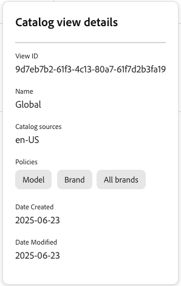

# Catalog views for Merchandising Services

{{$include /help/_includes/ccdm-shared/setup/catalog-view.md}}

## Manage catalog views

Use these instructions to manage catalog views:

- [Create a catalog view](#create-a-catalog-view)—Set the name, catalog source, policies, and price book. Then [specify the catalog view for recommendations and product discovery rules](#specify-catalog-views-for-recommendations-and-product-discovery-rules), review [catalog layers](#catalog-layers) that override product attributes, or [make the catalog view private](#make-a-catalog-view-private).
- [Edit a catalog view](#edit-a-catalog-view)—Update its sources, policies, price book, and protection settings.
- [Delete a catalog view](#delete-a-catalog-view)—Remove a catalog view you no longer need.
- [View catalog view details](#view-catalog-view-details)—Review a catalog view's configuration from the Catalog views table.

### Create a catalog view

Before creating a catalog view, prepare the following items as needed:

- A [catalog source](catalog-sources.md)
- [Policies](policies.md) that define product filters
- [Catalog layers](catalog-layer.md) if you need to override product attributes
- [Price books](pricebooks.md) for the pricing displayed in the view
- [Restricted access keys](restricted-access-keys.md) if you want to create a private catalog view

#### Configuration

In this section, you create a catalog view, select a [policy](policies.md), and a [price book](pricebooks.md).

1. From the left menu, go to **[!UICONTROL Store setup]**, and click **[!UICONTROL Catalog views]**.

1. Click **[!UICONTROL Create catalog view]**. ​

1. Configure the catalog view details:

    - **Name**—Enter the name of the catalog view, for example `Celport`. ​
    - **Catalog sources**—Select the [catalog source](catalog-sources.md), for example `en-US`.
    - **Catalog layers**—Review ingested layers and priority.
    - **Policies**—Use the drop-down to select the relevant policies. For example, "Brand," "Model". ​Make sure you have already [created a policy](policies.md).

1. Select the price book to link to the catalog view.

    - **Use all available price books**—This option pulls pricing data from all available price books.
    - **Allow selected price books only**—This option displays the **Add allowed price books** dialog. Use this dialog to select which specific price book to use for the catalog view.
    - **Single price book only**—Select this option if only one price book applies. This option is required if you want to configure a private catalog view, which can reference only one price book. See [Price book restriction on private catalog views](private-catalog-view.md#price-book-restriction-on-private-catalog-views).
    - **Disable pricing**—This option is not available at this time.

   >[!NOTE]
   >
   >A price book ID controls which pricing is requested. It does not restrict access to the catalog view. To restrict access, enable Catalog Protection to create a [private catalog view](private-catalog-view.md).

1. (Optional) Toggle **[!UICONTROL Catalog Protection]** to **[!UICONTROL Enabled]** to restrict this catalog view's data to clients with a valid signed token. See [Protect a catalog view](private-catalog-view.md#protect-a-catalog-view) for setup steps.

1. Click **[!UICONTROL Add]** to create the catalog view with the linked price books and policies.

The Catalog views page updates to display the new catalog view.​

After you complete these steps, the catalog view is now configured to display products and pricing based on your selected sources and policies.

#### Specify catalog views for recommendations and product discovery rules

You can specify a catalog view when you [create recommendation units](../merchandising/recommendations/create.md) or [merchandising rules](../merchandising/rules/add.md).

#### Catalog layers

Catalog layers let you override selected product attributes without changing the source catalog data. Use layers to customize names, descriptions, images, links, or metadata for a catalog view.

See [Catalog layers](catalog-layer.md).

#### Make a catalog view private

By default, a catalog view is public to client applications that can access the GraphQL Merchandising API. To restrict access, configure a private catalog view by enabling **[!UICONTROL Catalog Protection]**.

To learn how to protect a catalog view and verify that access is enforced, see [Private catalog views](private-catalog-view.md).

### Edit a catalog view

1. In the **[!UICONTROL Catalog views]** workspace, locate the catalog view.
1. To open the actions menu, select (**[!UICONTROL ...]**).
1. Select **[!UICONTROL Edit]** to access the catalog view editor.
1. Update the name, catalog sources, policies, price book information, and **[!UICONTROL Catalog Protection]** settings (including assigned restricted access keys) as needed.
1. Click **[!UICONTROL Save]**.

### Delete a catalog view

1. In the **[!UICONTROL Catalog views]** workspace, locate the catalog view.
1. To open the actions menu, select (**[!UICONTROL ...]**).
1. Select **[!UICONTROL Delete]**.
1. Confirm the deletion.

   When the confirmation dialog appears, click **[!UICONTROL Delete]**.

### View catalog view details

This option provides a quick way to see all the catalog view parameters, while staying on the **[!UICONTROL Catalog views]** table.

In the **[!UICONTROL Catalog views]** workspace, select the  for a catalog view to view its configuration details.

From here you can see catalog view configuration details, such as:

- View ID
- Name
- Catalog sources
- Policies
- Date Created
- Data Modified

Some of these configuration settings are needed as you set up your storefront or use the data ingestion API.
